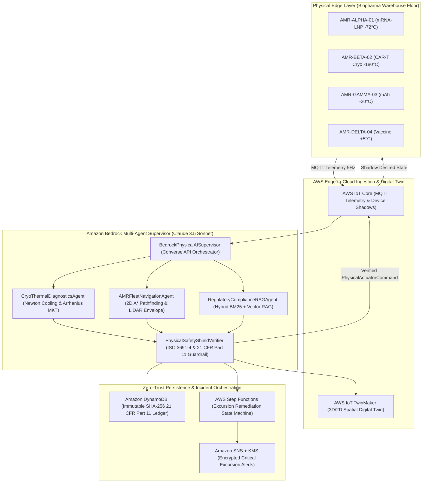

# ColdChain-MedBot: Autonomous Warehouse AMR & Biopharma Cold-Chain Physical AI Multi-Agent Supervisor

[](https://aws.amazon.com/bedrock/)
[](#system-architecture)
[](https://www.python.org/)
[](https://opensource.org/licenses/MIT)

**ColdChain-MedBot** is a production-grade **Physical AI Multi-Agent Supervisor** built on **Amazon Bedrock (Anthropic Claude)**, **AWS IoT Core**, **AWS IoT TwinMaker**, **Hybrid BM25 + Vector RAG**, **Amazon DynamoDB**, and **AWS Step Functions**.

It orchestrates a fleet of **Autonomous Mobile Robots (AMRs)** transporting ultra-cold mRNA lipid nanoparticles (`-80°C` to `-60°C`), cryogenic autologous CAR-T cellular therapies (`-150°C` to `-196°C` vapor-phase $\text{LN}_2$), monoclonal antibodies (`-20°C`), and refrigerated biologics (`+2°C` to `+8°C`) across a $120\text{m} \times 80\text{m}$ biopharma distribution facility.

---

## System Architecture



---

## Core Physical AI Capabilities

1. **Thermodynamic & Mechanical Diagnostics (`CryoThermalDiagnosticsAgent`)**:
   - Computes real-time **USP `<1079>` Arrhenius Mean Kinetic Temperature (MKT)**:
     $$T_K = \frac{\Delta H / R}{-\ln\left(\frac{1}{n}\sum_{i=1}^{n} e^{-\Delta H / (R \cdot T_i)}\right)}$$
   - Detects Stirling cryo-compressor cavitation ($>120\text{ Hz}$ harmonics), gasket pressure loss ($<90\text{ kPa}$), and projects time-to-ceiling breach in minutes.
2. **Spatial Kinematics & Collision-Free A\* Routing (`AMRFleetNavigationAgent`)**:
   - Plans collision-free 2D trajectories around static warehouse rack obstacles to `LN2_RECHARGE_DOCK`, `QUARANTINE_ISOLATION_LOCK`, or `OUTBOUND_AIRLOCK_C`.
   - Enforces **ISO 3691-4** dynamic speed governing based on 360° LiDAR obstacle proximity.
3. **Hybrid BM25 + Vector Regulatory RAG (`RegulatoryComplianceRAGAgent`)**:
   - Combines lexical BM25 and dense vector cosine similarity with domain payload boosting across **FDA 21 CFR Part 11**, **USP `<1079>`**, **21 CFR 1271.260**, **WHO PQS E003**, and **ISO 3691-4:2023** SOPs.
4. **Deterministic Neuro-Symbolic Safety Shield (`PhysicalSafetyShieldVerifier`)**:
   - Guarantees that no LLM hallucination can ever violate physical safety limits: enforces hard LiDAR emergency stop ($<0.45\text{m} \rightarrow 0.0\text{ m/s}$), corridor speed throttling ($<2.0\text{m} \rightarrow \le 0.6\text{ m/s}$), low-battery diversion ($<15\%\text{ SoC}$), and signs every command with a non-repudiable **SHA-256 cryptographic hash**.
5. **Interactive 2D Warehouse Digital Twin & Fault-Injection Console (`dashboard_ui.py`)**:
   - Real-time $120\text{m} \times 80\text{m}$ spatial visualization of all 4 AMRs, 360° LiDAR clearance envelopes, A\* trajectory paths, and live fault injection (`CRYO_LN2_VALVE_FAILURE`, `COMPRESSOR_CAVITATION_SPIKE`, `LIDAR_CORRIDOR_OBSTACLE`, `BATTERY_CRITICAL_DRAIN`).
6. **Multi-Cloud AI Gateway & Circuit-Breaker Failover (`MultiCloudModelRouter`)**:
   - Routes primary multi-agent synthesis through **Amazon Bedrock (`anthropic.claude-3-5-sonnet-20241022-v2:0`)** with automated circuit-breaker failover to **Google Cloud Vertex AI (`vertex_ai/gemini-2.5-pro`)** and real-time token/cost telemetry.
7. **Executive Pre-Sales ROI & FDA 21 CFR Part 11 Compliance Engine (`presales_roi_engine.py`)**:
   - Quantifies prevented biologic batch spoilage ($\text{USD}$), autonomous safety interventions, Mean Time to Remediate ($\text{MTTR}$) reduction ($99.96\%$ vs. $18.5\text{-min}$ manual QA), and 100% SHA-256 electronic signature audit integrity.

---

## Repository Structure

```text
coldchain-medbot-physical-ai/
├── pyproject.toml
├── README.md
├── docs/
│   └── ARCHITECTURE_AND_PRESALES_BRIEF.md
├── infrastructure/
│   ├── cdk_stack.py                         # AWS CDK / CloudFormation Zero-Trust IaC Stack
│   └── ci_pipeline.yml                      # CI/CD Pipeline: Pytest, Closed-Loop Sim & CDK Synthesis
├── src/
│   └── coldchain_medbot/
│       ├── __init__.py
│       ├── cli.py                           # Closed-loop Physical AI CLI simulation runner
│       ├── domain/
│       │   └── models.py                    # Telemetry schemas, thermal envelopes & actuator commands
│       ├── simulation/
│       │   └── edge_physics_engine.py       # 120m x 80m warehouse kinematics, A*, cryo & fault injection
│       ├── rag/
│       │   └── knowledge_base.py            # Hybrid BM25 + Vector RAG over FDA/USP/ISO SOPs
│       ├── agents/
│       │   ├── specialist_agents.py         # 4 Specialist Physical AI subagents & Safety Shield
│       │   ├── multicloud_router.py         # Amazon Bedrock -> Google Vertex AI circuit-breaker router
│       │   └── bedrock_supervisor.py        # Amazon Bedrock (Claude) Multi-Agent Supervisor
│       ├── reporting/
│       │   └── presales_roi_engine.py       # Executive Pre-Sales ROI & 21 CFR Part 11 report generator
│       ├── aws/
│       │   └── iot_twin_bridge.py           # AWS IoT Core Shadow, TwinMaker, DynamoDB & Step Functions
│       └── api/
│           ├── dashboard_ui.py              # Interactive 2D Warehouse Digital Twin & Fault Console UI
│           └── server.py                    # FastAPI REST Control Plane & Digital Twin API
└── tests/
    └── test_physical_ai_orchestrator.py     # Pytest unit & integration verification suite (7 tests)
```

---

## Quickstart & Local Execution

### 1. Run the Closed-Loop Physical AI Multi-Agent Simulation (CLI)
```bash
PYTHONPATH=src python3 -m coldchain_medbot.cli --cycles 2
```

### 2. Run the Test Suite
```bash
PYTHONPATH=src pytest -v
```

### 3. Launch the Interactive 2D Warehouse Digital Twin Console & FastAPI Control Plane
```bash
PYTHONPATH=src uvicorn coldchain_medbot.api.server:app --reload --port 8080
```
Then open **`http://localhost:8080/`** in your browser to interact with the 2D Warehouse Digital Twin, inject physical faults, toggle **Amazon Bedrock $\rightarrow$ Google Vertex AI failover**, and view live **Pre-Sales ROI & 21 CFR Part 11** telemetry.

---

## Author

**Samuel K. Quansah, M.S.**  
*Cloud Architect & Security | Sec+ | Pre-Sales & Delivery | Amazon Bedrock & Zero-Trust AWS | Vertex AI | RAG | Claude | Codex | LangGraph | Rails | React.js | GraphQL | AI/SI @ CALMU | Blindlabs.dev*  
- GitHub: [github.com/samuelQUANSAH](https://github.com/samuelQUANSAH)
